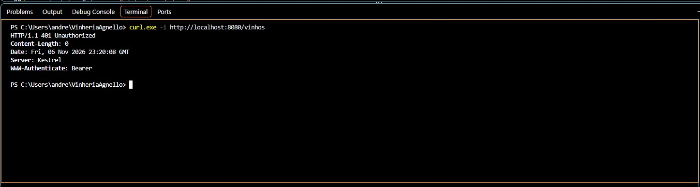
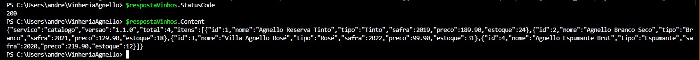
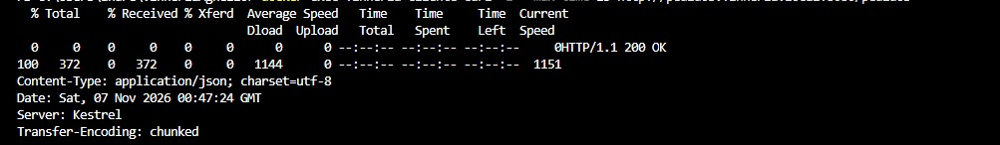
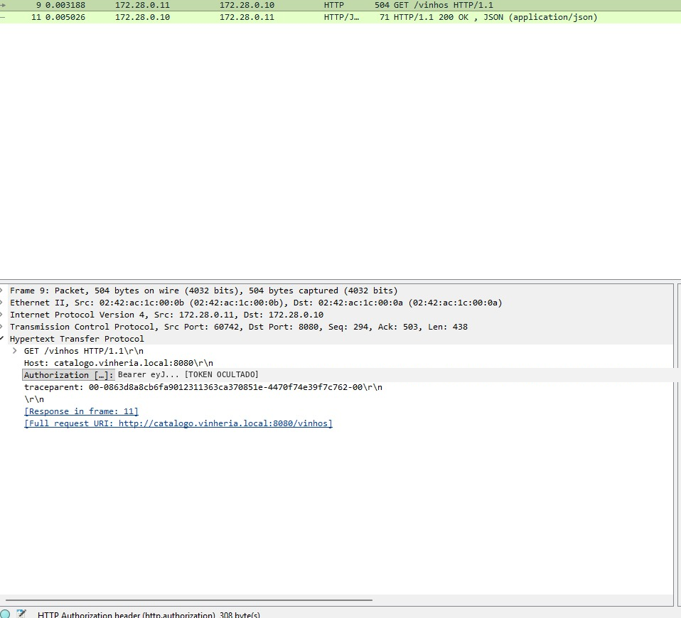
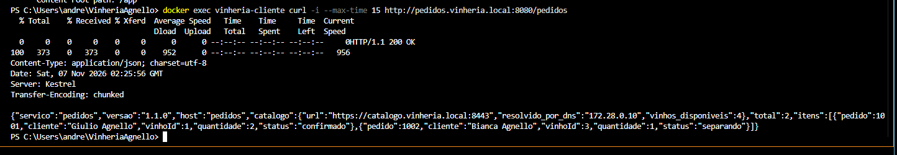
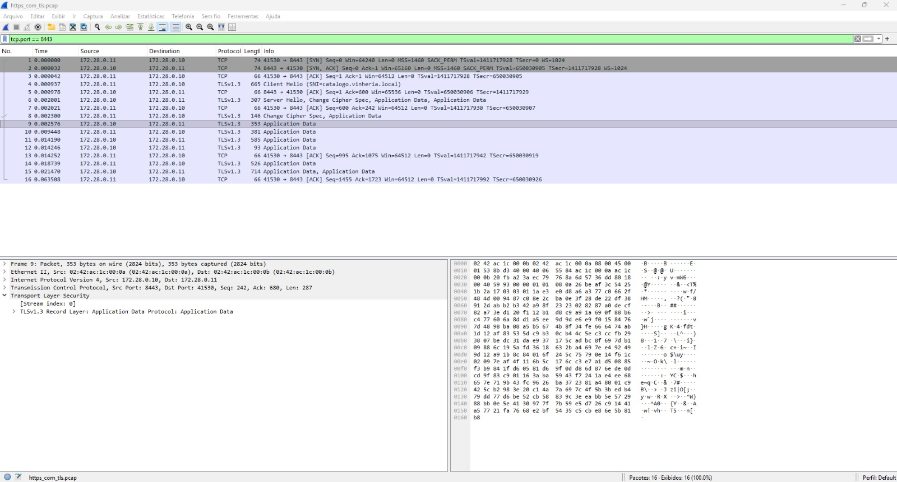

# Fase 7 — Vinheria Agnello

Entregáveis das atividades da fase 7:

| Item | Atividade | Onde está |
|---|---|---|
| 1 | Serviços I — servidor DHCP e DNS | `infra/` (rede Docker, dnsmasq com DHCP + DNS) |
| 2 | DevOps — repositório + pipeline Jenkins | `services/` (esqueleto dos 2 microsserviços), `jenkins/` (imagem, `Jenkinsfile`, pasta de publicação) |
| 3 | Comunicação segura entre microsserviços — REST, JWT e Wireshark | `services/`, `infra/` e `evidencias/seguranca/` |

## Os dois microsserviços simulados

Decisão do grupo (27/10): **Catálogo de Vinhos** e **Pedidos**, escolhidos no estudo de
microsserviços da fase 6. Ambos são APIs mínimas em .NET 10, sem dependência externa.

- `catalogo.vinheria.local:8080` — `GET /vinhos`, `GET /health`
- `pedidos.vinheria.local:8080` — `GET /pedidos` (consulta o Catálogo **pelo nome DNS**), `GET /health`

## Item 1 — rede, DNS e DHCP

Tudo em Docker Compose (`infra/docker-compose.yml`): rede própria `vinheria-net` com
subnet fixa `172.28.0.0/24` e IP fixo por serviço.

| Serviço | IP | Papel |
|---|---|---|
| `dns` | 172.28.0.53 | dnsmasq: zona `vinheria.local` (A, CNAME, PTR) + servidor DHCP |
| `catalogo` | 172.28.0.10 | microsserviço de Catálogo |
| `pedidos` | 172.28.0.11 | microsserviço de Pedidos |
| `cliente` | DHCP | container de testes (nslookup, getent, curl) |

```bash
cd infra
docker compose up -d --build
docker compose ps
```

Provas (rodam dentro da rede, por nome):

```bash
# DNS direto e reverso
docker compose exec cliente nslookup catalogo.vinheria.local
docker compose exec cliente nslookup 172.28.0.11
docker compose exec cliente getent hosts catalogo.vinheria.local

# Pedidos chamando o Catálogo pelo nome (não pelo IP)
docker compose exec cliente curl -s http://pedidos.vinheria.local:8080/pedidos

# DHCP: concessão real (DORA) + leases do servidor
docker compose exec dhcp-cliente /scripts/lease.sh
docker compose exec dns cat /var/lib/misc/dnsmasq.leases
```

Escopo DHCP: `172.28.0.100`–`172.28.0.200`, concessão de 12h, gateway `172.28.0.1`,
DNS `172.28.0.53`; reserva fixa de `172.28.0.150` para o MAC do container `dhcp-cliente`
(`infra/dhcp/dhcp-hosts.conf`). Saída completa das provas: `evidencias/item1-rede-dns-dhcp.md`.

## Item 2 — Jenkins: build e deploy

```bash
cd jenkins
docker compose up -d --build      # Jenkins LTS + .NET SDK 10, porta 8080
```

Pipeline (`jenkins/Jenkinsfile`, versionado): stage **Build** (`echo "Deploy da Vinheria"` +
`dotnet publish` dos dois serviços) e stage **Deploy** (copia o artefato para a pasta de
publicação, com `BUILD_INFO.txt` contendo build, data e hora).

- **Pasta de publicação:** `Fase7/jenkins/publicacao/` no host
  (`/var/jenkins_home/publicacao` dentro do container).
- Estrutura publicada: `publicacao/<serviço>/` com os DLLs prontos (`dotnet <serviço>.dll`).
- Cada build grava `publicacao/<serviço>/BUILD_INFO.txt` com número do build, commit e
  timestamp — é a prova de que o deploy rodou.

Evidências: `evidencias/item2-jenkins.md`.

## Evidências (execução real em 02/11/2026)

- `evidencias/item1-rede-dns-dhcp.md` — rede, DNS (direto/reverso/CNAME), concessão DHCP e **reserva por
  serviço** (catálogo, pedidos e cliente de teste)
- `evidencias/item2-jenkins.md` — dois builds verdes, console e artefato publicado
- `evidencias/jenkins-historico-builds.png` e `evidencias/jenkins-console-build2.png` — prints do Jenkins
- `evidencias/prints/` — prints de cada etapa: `rede.png`, `dns.png`, `dhcp.png`, `chamada.png`, `publicacao.png`


## Item 3 — Comunicação segura entre microsserviços (HTTP + JWT + HTTPS)

### Objetivo

Implementar autenticação JWT entre os microsserviços de Pedidos e Catálogo de Vinhos, demonstrando a comunicação REST e comparando o tráfego HTTP sem criptografia com HTTPS utilizando TLS 1.3.

### Comunicação REST

A comunicação entre os serviços utiliza requisições HTTP seguindo o padrão REST.

O serviço de Pedidos consulta o Catálogo para obter informações sobre os vinhos disponíveis.

REST foi escolhido em vez de mensageria porque essa integração exige uma resposta imediata do Catálogo para concluir a consulta de Pedidos. A comunicação síncrona também facilita a demonstração da autenticação e dos códigos de resposta HTTP.

A mensageria seria mais adequada para eventos assíncronos, como notificações de pedidos ou atualizações de estoque.

### Autenticação JWT

O Catálogo implementa o endpoint `POST /auth/login`, responsável por validar as credenciais do serviço de Pedidos e gerar um JWT.

O token utiliza assinatura HS256, possui validade de 10 minutos e é validado quanto à assinatura, ao emissor, à audiência e à expiração.

As credenciais e a chave secreta são fornecidas por variáveis de ambiente, sem serem armazenadas diretamente no código-fonte.

Fluxo de autenticação:

1. Pedidos envia suas credenciais ao endpoint `/auth/login`.
2. Catálogo valida as credenciais e retorna o JWT.
3. Pedidos envia o token no cabeçalho `Authorization: Bearer`.
4. Catálogo valida o token e autoriza o acesso a `/vinhos`.

Os endpoints `/vinhos` e `/vinhos/{id}` exigem autenticação. O endpoint `/health` permanece público.

### Testes de autenticação

Foram realizados testes para verificar a proteção da API:

| Cenário | Resultado |
|---|---|
| GET /vinhos sem token | 401 Unauthorized |
| POST /auth/login com credenciais válidas | 200 OK |
| GET /vinhos com JWT válido | 200 OK |
| Pedidos consultando Catálogo com JWT | 200 OK |

A comunicação também foi validada na rede Docker, utilizando os nomes DNS internos dos serviços.

### Comunicação HTTP e HTTPS

Para demonstrar a diferença entre os protocolos, o Catálogo foi configurado com duas portas:

| Porta | Protocolo | Finalidade |
|---|---|---|
| 8080 | HTTP | Demonstração sem criptografia |
| 8443 | HTTPS | Comunicação protegida por TLS |

Foi utilizado um certificado autoassinado de teste para `catalogo.vinheria.local`.

O serviço de Pedidos foi configurado para confiar nesse certificado e validar a conexão TLS.

Na configuração HTTPS, o serviço de Pedidos utiliza o endereço:

`https://catalogo.vinheria.local:8443`

O acesso do cliente de testes ao serviço de Pedidos permanece em HTTP na porta 8080. A proteção HTTPS demonstrada corresponde à comunicação entre Pedidos e Catálogo.

### Análise com Wireshark

Foram realizadas capturas de tráfego utilizando tcpdump e Wireshark.

**HTTP sem TLS**

A captura demonstrou as requisições `POST /auth/login` e `GET /vinhos` em texto legível.

Foi possível identificar o cabeçalho `Authorization: Bearer`, contendo o JWT, além das credenciais de teste transmitidas no corpo da requisição de login.

Isso demonstra que a assinatura JWT não oferece confidencialidade durante o transporte. Um agente com acesso ao tráfego pode visualizar e potencialmente reutilizar um token ainda válido.

**HTTPS com TLS 1.3**

A segunda captura demonstrou a negociação TLS e registros do tipo `Application Data`.

Diferentemente do HTTP, as requisições e os tokens não ficaram legíveis na captura, pois o conteúdo da aplicação estava criptografado.

O TLS protege a confidencialidade e a integridade dos dados transmitidos e autentica o servidor quando o certificado é validado corretamente.

Entretanto, metadados como endereços IP, portas, horários e volume de tráfego continuam observáveis. O uso de certificado autoassinado também exige uma configuração explícita de confiança no cliente.

### Evidências

As capturas foram armazenadas localmente em `evidencias/seguranca/`.

- `http_sem_tls.pcap` — captura HTTP sem criptografia.
- `https_com_tls.pcap` — captura HTTPS com TLS 1.3.

Os arquivos PCAP podem conter informações sensíveis de teste e não devem ser publicados no repositório.

As capturas de tela destinadas à entrega deverão ocultar senhas e valores completos dos tokens.

### Conclusão

A implementação demonstrou a autenticação entre os microsserviços utilizando JWT com assinatura HS256 e comunicação REST.

Os testes confirmaram o bloqueio de acessos não autenticados com HTTP 401 e a autorização de requisições válidas com HTTP 200.

A comparação realizada no Wireshark demonstrou que o HTTP permite visualizar credenciais e tokens, enquanto o HTTPS com TLS 1.3 protege o conteúdo transmitido.

Dessa forma, JWT e HTTPS cumprem funções complementares: o JWT permite autenticar e autorizar requisições, enquanto o TLS protege os dados durante o transporte.


### Evidências visuais — Item 3

#### 1. Acesso sem JWT — 401 Unauthorized

O Catálogo bloqueia requisições que não apresentam um JWT válido.



#### 2. Acesso com JWT — 200 OK

A requisição autenticada retorna os quatro vinhos cadastrados no Catálogo.



#### 3. Comunicação HTTP entre microsserviços

O serviço de Pedidos consulta o Catálogo utilizando REST e autenticação JWT.



#### 4. Proteção do Catálogo no Docker

Uma requisição direta ao Catálogo sem JWT retorna 401 Unauthorized.


#### 5. Captura HTTP no Wireshark

A captura HTTP demonstra que o cabeçalho Authorization: Bearer pode ser visualizado sem criptografia. O valor completo do token foi ocultado na imagem.



#### 6. Comunicação HTTPS entre microsserviços

O serviço de Pedidos consulta o Catálogo por HTTPS na porta 8443, utilizando JWT, e recebe uma resposta 200 OK.



#### 7. Captura HTTPS no Wireshark

O tráfego utiliza TLS 1.3. O Wireshark identifica registros Application Data, mas não consegue visualizar o JWT e o conteúdo HTTP em texto legível.

